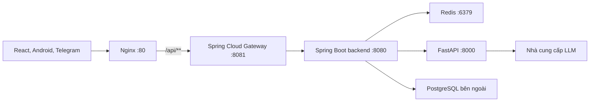

# UniHub Microservices — Phase 1

## Kiến trúc



Nginx phục vụ React SPA và đưa nguyên đường dẫn, query string, phương thức, body và các header ứng dụng qua Spring Cloud Gateway. Gateway dùng Spring Boot 4.0.6 và Spring Cloud 2025.1.5. Backend vẫn phát hành và xác thực JWT, cấp access token mới qua refresh token, kiểm tra role và xử lý CORS, rate limit, idempotency. Gateway chuyển tiếp các mã trạng thái và nội dung phản hồi của backend, bao gồm các lỗi 401 mà React và Android dùng để kích hoạt refresh. [Spring Cloud compatibility](https://spring.io/projects/spring-cloud/)

Nginx là dịch vụ duy nhất publish cổng host. Mạng `edge` nối Nginx với gateway. Mạng nội bộ `api` nối gateway với backend, và `cache` nối backend với Redis. Mạng `ai` nối backend với FastAPI và cho phép outbound để backend gọi PostgreSQL, mail, Telegram và FastAPI gọi LLM. Nginx lấy địa chỉ client từ kết nối đến nó và ghi vào `X-Forwarded-For`. Gateway chỉ giữ header chuyển tiếp từ địa chỉ Nginx cấu hình trên mạng `edge`. Nếu triển khai thêm load balancer, cấu hình Nginx nhận địa chỉ client từ load balancer đáng tin cậy.

## Hợp đồng API đã rà soát

- `GET /api/test` trả chuỗi kiểm tra backend. React chạy trong Docker tiếp tục dùng base URL tương đối `/api/v1`. Android `dockerLocal` tiếp tục trỏ đến Nginx qua `http://10.0.2.2/` với cổng mặc định.
- `/api/v1/auth/**` tiếp tục phục vụ đăng ký, login web, login app, refresh và `GET /me`. Backend vẫn có các kiểm tra riêng cho `/me` và đăng ký admin/staff. Access token đi qua header `Authorization: Bearer …`. Refresh token đi trong JSON.
- `/api/v1/workshops/**` giữ nguyên danh sách, truy vấn phân trang, chi tiết, attendee dành cho staff, lịch sử dành cho student, đăng ký, thanh toán và hủy. Header `Idempotency-Key` được chuyển tiếp.
- `/api/v1/checkins/sync`, `/api/v1/notifications`, `/api/v1/rooms` và `/api/v1/admin/**` tiếp tục thực thi xác thực và role theo từng controller. Với API thống kê admin, backend hiện trả 403 cho yêu cầu thiếu token và 400 kèm `Access Denied` cho JWT hợp lệ nhưng sai role. Các upload ảnh sơ đồ phòng và PDF tóm tắt vẫn dùng multipart. Nginx giữ giới hạn body 20 MB.
- `POST /api/v1/payments/process` và `POST /api/v1/telegram/webhook` đi qua gateway. Telegram webhook vẫn kiểm tra token tích hợp ở backend.
- Backend gọi FastAPI qua `POST /summarize` với multipart gồm `workshop_id` và `file`. FastAPI trả `workshop_id`, `summary` và `speaker`. Các cổng và endpoint quản trị của backend, gateway, Redis và FastAPI chỉ truy cập được trong mạng phù hợp.

## Chạy và kiểm tra

Từ thư mục gốc, tạo `.env.production` từ `.env.example`, cấu hình một PostgreSQL có thể truy cập từ Docker và điền các biến tích hợp cần dùng. Khi triển khai vào môi trường hiện hữu, giữ `JWT_ACCESS_SECRET` và `JWT_REFRESH_SECRET` đang dùng để các token đã phát hành tiếp tục hợp lệ. `REDIS_PASSWORD` có thể để trống. Khi đặt, Compose áp dụng cùng giá trị cho Redis và backend.

```sh
docker compose --env-file .env.production config --quiet
docker compose --env-file .env.production up -d --build --wait
docker compose --env-file .env.production ps
curl -fsS http://localhost/api/test
```

`FRONTEND_PORT` mặc định là 80. Nếu subnet Docker `172.29.86.0/24` đã được dùng, chọn subnet trống qua `EDGE_SUBNET`, đặt dải cấp IP động bên trong subnet qua `EDGE_IP_RANGE`, rồi đặt `NGINX_EDGE_IP` thành một IPv4 nằm trong subnet và ngoài dải cấp động. Dùng `docker compose exec` để kiểm tra probe nội bộ khi cần.

- Backend dùng `/actuator/health/liveness` cho trạng thái tiến trình và `/actuator/health/readiness` cho trạng thái sẵn sàng cùng PostgreSQL và Redis.
- Gateway dùng `/actuator/health`, FastAPI dùng `/health`, Redis dùng `PING` và Nginx kiểm tra `GET /`.
- Compose đợi Redis trước khi chạy backend, backend trước gateway và gateway trước Nginx. Backend vẫn phục vụ API lõi khi AI gặp sự cố.

Chạy gateway độc lập với JDK 25 và Maven bằng `mvn -f gateway/pom.xml spring-boot:run`. Mặc định gateway lắng nghe cổng 8081 và dùng backend tại `http://localhost:8080`. Có thể đặt `GATEWAY_PORT` hoặc `BACKEND_URL`. Quy trình chạy backend, React, FastAPI và Android thủ công ở README gốc vẫn dùng được. Với máy ảo Android, biến thể `manualDev` vẫn trỏ đến cổng backend 8080.

GitHub Actions chạy Maven cho gateway và backend, unit test và build Android, rồi khởi động stack test với PostgreSQL riêng để kiểm tra React/Nginx, FastAPI và các hợp đồng HTTP/JWT qua cả gateway lẫn backend. Để chạy riêng bộ test gateway, dùng `mvn -f gateway/pom.xml verify`.

## Rollback

Trước khi triển khai, ghi lại commit hoặc phiên bản image đang chạy, tên project Compose và bản cấu hình môi trường của phiên bản đó. Khi cần rollback, chuyển sang checkout hoặc artifact của bản ổn định trước Phase 1, cấp lại cấu hình môi trường và triển khai trong cùng project Compose.

```sh
docker compose -p <project-dang-chay> --env-file .env.production up -d --build --remove-orphans
curl -fsS http://localhost/api/test
```

Phiên bản trước đưa `/api/**` trực tiếp từ Nginx sang backend. Giữ nguyên PostgreSQL, JWT và các volume đang dùng. Phase 1 không đổi schema. Kiểm tra lại login web/app, refresh token và một API có yêu cầu role sau rollback.
